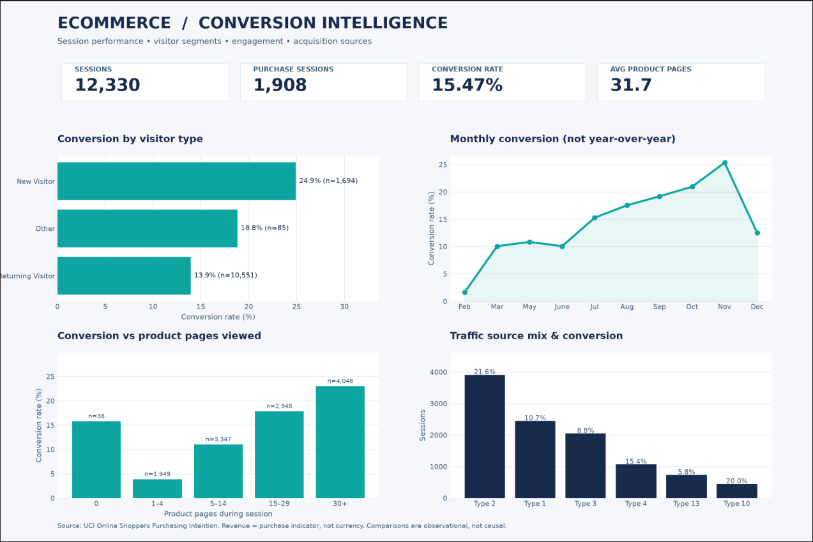

# E-commerce Conversion Analytics | SQL + Python + Statistics

**End-to-end Data Analyst portfolio project** analyzing which shopping sessions end in a purchase, how conversion differs by visitor type/traffic source/engagement, and how to plan a future randomized A/B experiment.

**Tools:** Python · Pandas · NumPy · SQLite (SQL) · SciPy · Matplotlib · Power BI (import instructions & DAX)

> **Data integrity:** `Revenue` is a **Boolean purchase flag**, **not** monetary revenue. This dataset has no order values, so sales, profit, AOV and LTV **cannot** be measured. Its session-level observations are **not** an A/B experiment. All segment comparisons are observational.

## Business questions

1. What proportion of sessions result in a purchase?
2. How does conversion differ between new vs returning visitors?
3. Which traffic types drive the most sessions, and how do their conversion rates compare?
4. How are product-page visits associated with purchase outcomes?
5. What sample size would a properly randomized **future** A/B test need?

## Dataset

[Online Shoppers Purchasing Intention Dataset (UCI)](https://archive.ics.uci.edu/dataset/468/online+shoppers+purchasing+intention+dataset) by C. Sakar & Y. Kastro, 2018, [DOI 10.24432/C5F88Q](https://doi.org/10.24432/C5F88Q), **CC BY 4.0**.

- **12,330 sessions**, **1,908 purchase sessions** and **10,422 non-purchase sessions** (per the official repository) — overall **15.47% purchase conversion**.
- The dataset has 18 original attributes covering engagement, traffic, visitor type and purchase outcome.
- No unique customer IDs, order amounts, or complete transaction dates are provided.

## Quick start (Windows / macOS / Linux)

```bash
python -m venv .venv
# Windows: .venv\Scripts\activate
# macOS/Linux: source .venv/bin/activate
pip install -r requirements.txt

# Full REAL analysis (auto-downloads the official UCI CSV; internet required):
python -m src.pipeline

# Offline demonstration only (synthetic data, clearly labelled):
python -m src.pipeline --demo

# Or load an already downloaded real CSV:
python -m src.pipeline --input "data/online_shoppers_intention.csv"

# Tests:
python -m pytest -q
```

If dataset download fails, visit the UCI link above and save `online_shoppers_intention.csv` in `data/`, then rerun the command.

## Executive summary — real UCI results

The analysis covers **12,330 shopping sessions** and **1,908 sessions with a purchase**, giving an overall **15.47% session conversion rate**.

| Segment | Sessions | Purchase conversion |
|---|---:|---:|
| New visitors | 1,694 | **24.91%** |
| Returning visitors | 10,551 | **13.93%** |
| Other | 85 | 18.82% |

**Key insight:** New-visitor sessions converted **10.98 percentage points more often** than returning-visitor sessions. Returning visitors accounted for **85.6%** of sessions, making them a priority for diagnostic research—not evidence that changing visitor status would increase conversion.

Other observations:
- Sessions with **30+ product pages viewed** converted at approximately **23%**, versus approximately **4%** for sessions with **1–4 pages**. Association does not imply causation.
- **Traffic Type 2**, the largest of the displayed traffic sources, showed approximately **21.6%** conversion; traffic codes are anonymized rather than named marketing channels.
- November showed the highest plotted monthly conversion (approximately **25%**), but the dataset does not include years, so this is **not** a longitudinal growth or year-over-year result.

**Statistical check:** The observed difference between new and returning sessions was significant in a chi-square association test (**p = 3.873 × 10⁻³¹**). The returning-minus-new difference was approximately **−10.98 percentage points** (approximate 95% CI: **[−13.142, −8.816] pp**). This is **observational, not an A/B test**, and sessions may not be independent users.

**Suggested follow-up:** Investigate returning-visitor friction and traffic composition, then validate a specific product improvement with an appropriately randomized A/B test. [Read the full findings](reports/real/FINDINGS.md).

## Dashboard — actual UCI results



The dashboard above shows real-data results as supplied from a pipeline run. A separate, clearly labeled **synthetic demo** remains available at [`reports/demo/dashboard.png`](reports/demo/dashboard.png).

## Repo structure

```text
Ecommerce_Conversion_Analytics/
├── README.md                         Documentation, methods & limitations
├── requirements.txt                  Python dependencies
├── data/README.md                    Dataset citation & download instructions
├── src/
│   ├── data.py                       Input validation and feature engineering
│   ├── demo.py                       Reproducible synthetic data (demo only)
│   ├── analysis.py                   Segments, confidence intervals, A/B planning
│   ├── report.py                     Dashboard chart generator
│   └── pipeline.py                   Runnable end-to-end pipeline
├── sql/
│   ├── 01_overview.sql               Conversion KPIs
│   ├── 02_visitor_segments.sql       Segmentation
│   ├── 03_monthly.sql                Dimension-table JOIN
│   ├── 04_traffic_rank.sql           CTE + window RANK
│   └── 05_product_engagement.sql     Session engagement
├── powerbi/
│   ├── measures.dax                  Power BI measures
│   └── POWER_BI_GUIDE.md            Instructions to build a BI report
├── tests/test_pipeline.py           Integrity and SQL parity checks
├── reports/real/                    Actual UCI dashboard & findings
└── reports/demo/                    SYNTHETIC DEMO — visualization & CSVs
```

## Analysis approach

**1. Data quality.** Read the original CSV; verify all required columns, missing values, valid purchase flags, and plausible bounce/exit rates. Preserve identical rows: two distinct sessions could share identical features. Add a stable `session_id`.

**2. Metrics.** Sessions = row count; purchases = number of `Revenue=True` rows; conversion rate = purchases / sessions. Aggregate by month, visitor type, traffic type and product-page bucket.

**3. SQL.** Use an embedded SQLite database, group-by aggregation, a month dimension join, a CTE and a `RANK()` window. All SQL result tables are exported to CSV. Queries are in `sql/`.

**4. Statistics.** Compare *New_Visitor* vs *Returning_Visitor* with a chi-square test for association (not an A/B test). Report the difference in conversion **percentage points** and an approximate 95% confidence interval. P-values describe evidence of an association; they do not prove causation.

**5. Future A/B test planning.** Estimate equal-group sample sizes for **hypothetical** 10%, 15% and 20% relative lifts in conversion. Use two-sided α=0.05 and 80% power. Sample size output is named `ab_test_plan_NOT_RESULTS.csv`. No experiment was conducted.

**6. Power BI.** CSV export and DAX measures ready for Power BI Desktop. A `.pbix` is **not** included; rebuild steps live in `powerbi/POWER_BI_GUIDE.md`.

## Real output files

After running `python -m src.pipeline`, `reports/real/` contains the following outputs (this repository includes the real dashboard and a findings summary; other generated artifacts are excluded from Git):

- `dashboard.png` — a four-panel analytics dashboard
- `FINDINGS.md` — automatically generated analysis summary with honest limitations
- `sessions_clean.csv` — validated flat table for Power BI and Excel
- `conversion_analysis.db` — embedded SQLite database
- `sql_*.csv`, `segment_*.csv` — query/segment reports
- `observational_test.csv` — statistical check
- `ab_test_plan_NOT_RESULTS.csv` — A/B planning calculations **only**

## Recommendations / limitations

Use findings to **form hypotheses**, such as prioritizing high-volume low-converting segments, and then validate ideas with genuine randomized experiments. These data **cannot establish whether changing page count, traffic source or visitor type causes purchases**. `PageValues` is potentially outcome-dependent and should not be treated as a causal driver or early-stage predictor without leakage checks. Since months lack years, avoid making multi-year trends or retention claims. Small traffic segments can have unstable rates; rank queries require at least 100 sessions.

## Suggested CV entry (use after you understand & run the project)

**E-commerce Conversion Analytics | Python, SQL, Pandas, Statistics**  
- Analyzed 12,330 e-commerce sessions with Python, Pandas and SQL, measuring **15.47% session conversion** and customer segment performance.  
- Created an analytics dashboard and a chi-square statistical comparison; identified a **10.98 percentage-point observational conversion gap** between new and returning visitors.  
- Planned a future A/B-test sample size; **no randomized experiment was conducted**.

**Attribution:** Sakar, C. & Kastro, Y. (2018). Online Shoppers Purchasing Intention Dataset. UCI Machine Learning Repository. https://doi.org/10.24432/C5F88Q (CC BY 4.0).
