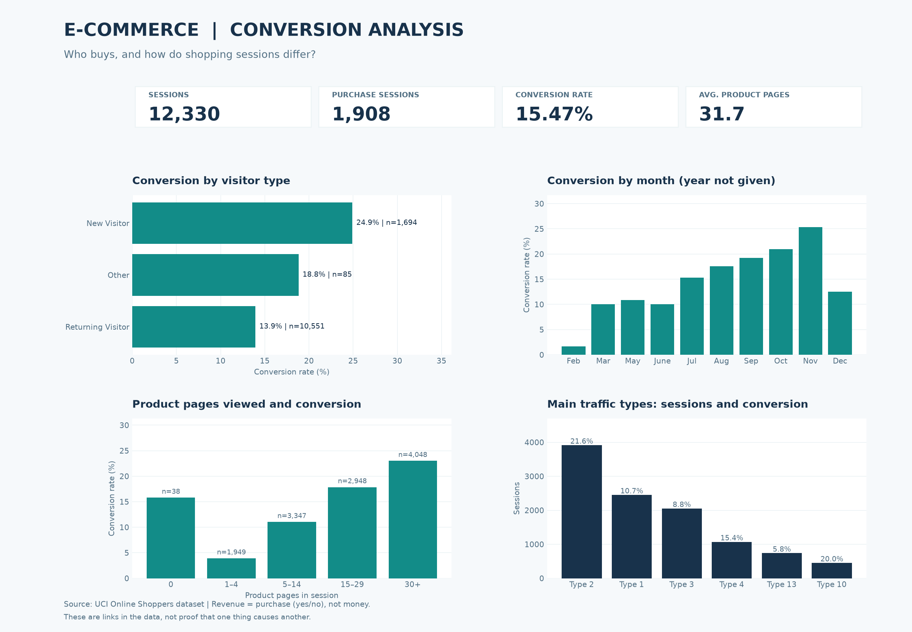

# E-commerce Conversion Analytics

**A Data Analyst project with Python, SQL, and statistics**

I studied online shopping sessions to answer one question: **Which visitors buy, and where should a business look for problems?**

This project uses a public dataset from UCI. I cleaned the data, wrote SQL queries, compared visitor groups, and made a dashboard. I also checked one difference with a chi-square test.

**Tools:** Python, pandas, SQLite, SQL, SciPy, Matplotlib. I also prepared a guide and DAX measures for a future Power BI report. **The Power BI `.pbix` file is not finished yet.**

## Main results

| Measure | Result |
| --- | ---: |
| Shopping sessions | **12,330** |
| Sessions with a purchase | **1,908** |
| Overall purchase conversion | **15.47%** |
| New visitor conversion | **24.91%** |
| Returning visitor conversion | **13.93%** |

**Main finding:** New visitor sessions had a **10.98 percentage-point higher** conversion rate than returning visitor sessions. Returning visitors made up about **85.6%** of all sessions. This is a large group, so it is a good place to start more research.

The chi-square test gave **p = 3.87 × 10⁻³¹**. The result shows a strong link between visitor type and purchase conversion in this dataset. **It does not prove why people buy.** This is not an A/B test.

### Dashboard (real UCI data)



*The dashboard is a saved result of the real dataset. Run the Python pipeline to create a new version with the latest chart design.*

## Business ideas

1. **Check returning visitors first.** They are the biggest group, but their conversion rate is lower. We need more data about their traffic sources and shopping steps to understand why.
2. **Look at product navigation.** Sessions with 30+ product pages had about 23% conversion. Sessions with 1–4 pages had about 4%. This is a link, not proof that viewing more pages makes people buy.
3. **Plan a real A/B test later.** First choose one change, such as an easier way to find products. Then test it with random groups and a clear success measure.

See [Business Findings](reports/real/FINDINGS.md) for more details and limits.

## Questions I studied

- How many sessions end in a purchase?
- How does conversion change by visitor type, traffic type, or month?
- How are product page views linked to purchases?
- Can traffic source help explain the gap between new and returning visitors?
- How could I plan a future A/B test?

## How to run the project

**1. Get the code**

```bash
git clone https://github.com/AdiletN/ecommerce-conversion-analytics.git
cd ecommerce-conversion-analytics
```

**2. Install Python packages** (Python 3.10 or newer)

```bash
python -m venv .venv
```

On Windows PowerShell:

```powershell
.venv\Scripts\Activate.ps1
```

On macOS or Linux:

```bash
source .venv/bin/activate
```

Then:

```bash
pip install -r requirements.txt
```

**3. Run the real analysis**

```bash
python -m src.pipeline
```

The program tries to download the [UCI dataset](https://archive.ics.uci.edu/dataset/468/online+shoppers+purchasing+intention+dataset). If the download does not work, download `online_shoppers_intention.csv` yourself and save it in the `data/` folder. Then run the command again.

You can also choose a local CSV file:

```bash
python -m src.pipeline --input data/online_shoppers_intention.csv
```

**4. Run a test with fake data** (no internet needed)

```bash
python -m src.pipeline --demo
```

Fake data is only for checking the code. **Do not use fake results in your CV.**

**5. Run automated tests**

```bash
python -m pytest -q
```

## Where to find the work

| Folder or file | What is inside |
| --- | --- |
| `src/` | Python cleaning, analysis, charts, and pipeline |
| `sql/` | Six SQL queries, including CTE, JOIN, and window functions |
| `sql/06_visitor_traffic.sql` | Extra check of visitor types by traffic type |
| `reports/real/dashboard.png` | Dashboard made with real UCI data |
| `reports/real/FINDINGS.md` | Business findings written for this dataset |
| `reports/real/RUN_SUMMARY.md` | New summary made after each run (local file) |
| `reports/demo/` | Results from fake data, clearly marked |
| `powerbi/` | Power BI guide and DAX measures; no `.pbix` yet |
| `tests/` | Automated Python and SQL checks |

The script also creates a local SQLite database and CSV tables. These large temporary files are not needed in GitHub.

## Data and limits

Data: [Online Shoppers Purchasing Intention Dataset, UCI](https://archive.ics.uci.edu/dataset/468/online+shoppers+purchasing+intention+dataset) (Sakar and Kastro, 2018, [DOI](https://doi.org/10.24432/C5F88Q), CC BY 4.0).

Each row represents a shopping session. The `Revenue` field means **purchase: yes or no**. It is **not** an amount of money. So I cannot calculate sales, profit, average order value, or customer lifetime value. The data has months but no years, so I cannot show year-to-year growth. The results show patterns, not cause and effect.

**Next work:** Build and save the Power BI report with Power BI Desktop. See the [Power BI guide](powerbi/POWER_BI_GUIDE.md).
